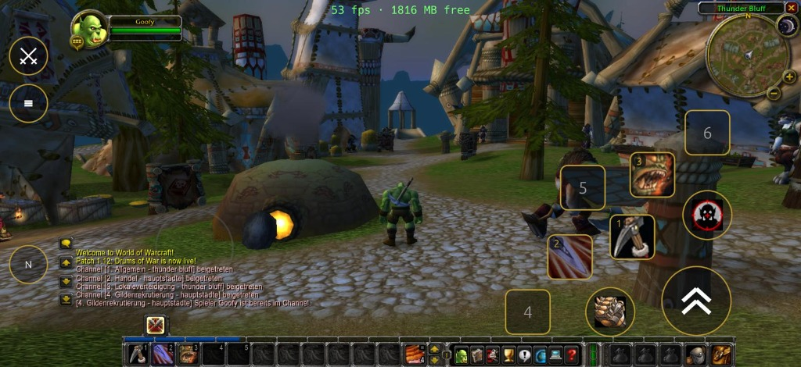
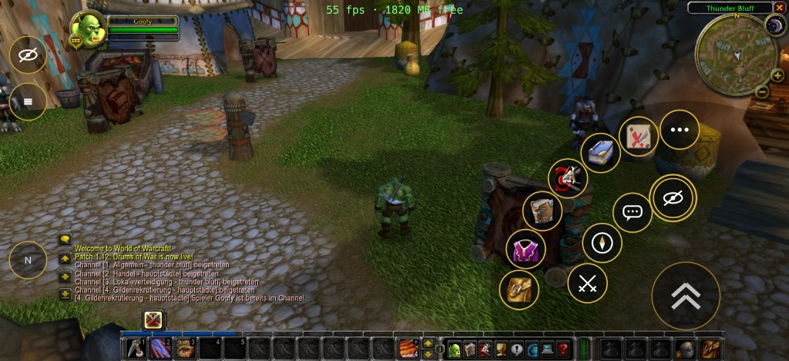
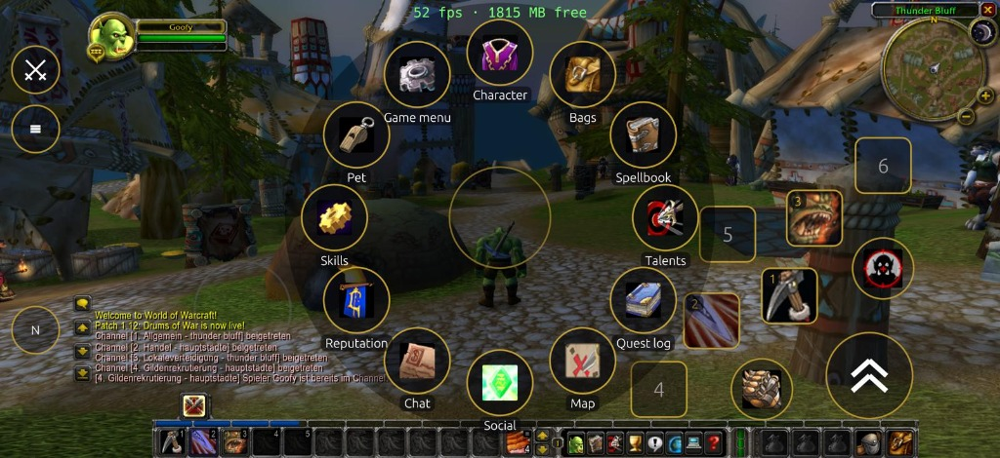
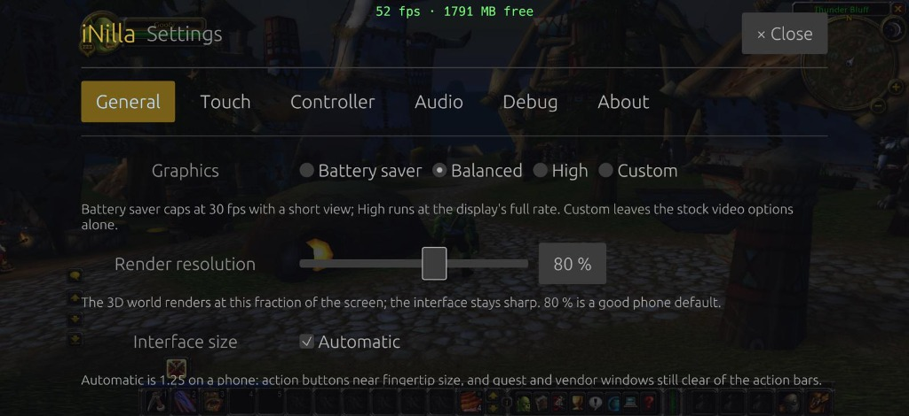

<div align="center">
  <h1>iNilla</h1>
  <p><b>benilla — the from-scratch World of Warcraft 1.12.1 client in Rust — on the iPhone iOS 17.0+</b></p>
  
</div>

**iNilla** is an iOS build of [benilla](https://github.com/samwhosung/benilla), made to be
sideloaded with **SideStore** (or AltStore / LiveContainer), with everything a phone needs around
the unchanged game:

- **Touch controls** that cost no screen space until a thumb lands — a floating movement stick,
  jump with a ring of action slots around it (with real icons and cooldowns), switchable
  **views** (Combat / Explore / Social / Minimal), a radial menu for every window, drag-to-look,
  pinch-zoom, and the stock interface usable by finger (tap = click, long press = right click,
  drag = move items, two fingers = scroll). A **layout editor** moves, resizes, rebinds and hides
  every element.
- **Controllers** — Backbone One, Xbox, DualSense, any MFi pad — in WoW Forever's layout: sticks
  move and look, LB/RB cycle targets, the triggers switch the face buttons and d-pad between four
  layers (32 bindings), a radial menu, a virtual cursor that opens by itself with loot, vendor and
  quest windows. Fully remappable.
- **A launcher**: server profiles (LAN or internet, with a realm-address override for NAT),
  accounts with passwords in the iOS Keychain, one-tap login and account switching, auto-login.
- **Game data, once**: copy your own `Data` folder in with Finder / the Files app, or download
  it directly from a server with HTTP data hosting (resumable, SHA-256 verified). The companion
  [iNilla server](https://github.com/Martze96/iNilla-server) is an optional helper repository (basically standard
  vmangos bundled with a game-data HTTP endpoint) to easily get a server with data hosting running in Docker. The app contains no Blizzard files.
- **A fast debug loop without a Mac**: a remote console in any browser on the same Wi-Fi (live
  log, Lua, commands, screenshots, config files), session logs and crash reports in the Files app,
  and a desktop build that rehearses the touch HUD and controller.

<p align="center">
  
  
</p>
<p align="center">
  
  
</p>

## Download & Install

1. **Download the `.ipa`**: Grab the latest release package (`iNilla-*.ipa`) from [**Releases**](https://github.com/Martze96/iNilla/releases).
2. **Sideload (iOS 17.0+)**:
   - **SideStore / AltStore**: In SideStore/AltStore on your phone, go to **My Apps** → **＋** and select the `.ipa`. It will be signed with your Apple ID.
   - **LiveContainer**: You can also run iNilla directly as a LiveContainer guest without consuming an app ID slot.
3. **Game Data (One-Time Setup)**:
   - On first launch, the app prompts for the 1.12.1 game files (the app contains no Blizzard files).
   - **Easiest:** Download them over Wi-Fi from your [**iNilla server**](https://github.com/Martze96/iNilla-server) (automated, resumable, and SHA-256 verified).
   - **Alternative:** Copy your existing `Data` folder directly into the app using Finder or the iOS Files app (see [docs/DATA.md](docs/DATA.md)).

Everything is built on Linux except the final link, which is a few minutes on a macOS runner —
see [docs/IOS-BUILD.md](docs/IOS-BUILD.md).

| read | for |
|---|---|
| [docs/INILLA.md](docs/INILLA.md) | what iNilla is made of, the controls, the settings |
| [docs/IOS-BUILD.md](docs/IOS-BUILD.md) | building and installing the `.ipa` (SideStore, LiveContainer), CI and its minutes |
| [docs/DATA.md](docs/DATA.md) | getting the game data onto the phone; the data host |
| [docs/DEBUGGING.md](docs/DEBUGGING.md) | the remote console, logs, crash reports, the desktop rehearsal |
| [docs/UPSTREAM.md](docs/UPSTREAM.md) | syncing benilla, and every upstream file iNilla touches |

Servers: any 1.12.1 core benilla supports — **vmangos** (what benilla develops against) and
**cMaNGOS** — with **Warden disabled** (benilla does not implement it). (Tip: use [iNilla server](https://github.com/Martze96/iNilla-server)
if you want a ready-to-run vmangos instance that already serves game data to the app). Clients: English (enUS)
1.12.1, build 5875. iNilla is an independent fan project, not affiliated with or endorsed by
Blizzard Entertainment.

---

*Everything below is upstream benilla's README, unchanged.*

<div align="center">
  <h1>benilla</h1>
  <p><b>A complete World of Warcraft 1.12.1 client, written from scratch in Rust and <a href="https://bevy.org">Bevy</a></b></p>
  <p>
    <a href="https://discord.gg/wJSJx467G4"></a>
    <a href="https://www.youtube.com/playlist?list=PLdCnpZNKxyb8"></a>
    <a href="LICENSE-MIT"></a>
  </p>
</div>

benilla plays the whole game: character creation, questing and professions, dungeons and raids,
battlegrounds and honor, groups, guilds, trade, mail and the auction house, on the stock 1.12
interface and with your addons. It connects to a 1.12.1 server over the original protocol and
reads the game's data from your own 1.12.1 install. Every file format, the network protocol and
the interface engine are written from scratch, with no original client code, no third-party WoW
crates and no bundled game assets.

## What's inside

- **Formats:** readers for the whole asset stack (the MPQ patch chain, BLP, DBC, ADT, WDT, WDL, M2
  and WMO), wired into Bevy as an asset source.
- **World:** terrain streamed out to the horizon, portal-culled buildings with interior lighting,
  doodads and ground clutter, swimmable water, sky and weather, and the client's own day/night
  lighting, fog and gamma.
- **Models:** GPU-skinned M2s with the full animation controller, particles, ribbons and the spell
  visuals, and characters end to end: customization, the armor composite, weapons with their
  enchant glows, forms, stealth and mounts.
- **Movement:** networked movement in both directions, the server-granted modes from slow fall to
  roots, a follow camera with collision, boats, zeppelins and taxi flights.
- **Networking:** SRP6 auth through world-session crypto and the object mirror into the ECS,
  covering the game from movement and chat through combat, spells, groups and raids, quests,
  trade, mail, the auction house and battlegrounds.
- **Interface:** a FrameXML and Lua engine that runs the stock 1.12 interface off your install's
  patch chain, and third-party 1.12 addons: Questie, pfUI, Bagnon, Bartender2 and most others
  run. By choice, the options window and the ESC menu follow the Classic Era client's rather than
  1.12's.
- **Audio:** music, ambience and effects under the client's own selection and crossfade rules,
  with interior and underwater transitions and zone reverb.

The format readers and the UI engine core are plain Rust with no Bevy in them, and the world
renderer runs with no game attached. [`docs/MAP.md`](docs/MAP.md) maps every crate and subsystem,
generated from the code.

## Status

Complete and fully playable. What is left:

- The long tail of small features that separates a working client from a finished one, tracked
  as [issues](https://github.com/samwhosung/benilla/issues).
- Addons, options and performance, ongoing.

benilla is a faithful 1.12.1 client and the foundation people build on. There are no prebuilt
downloads: a packaged build, a particular server's changes or anything 1.12.1 never had belongs
in a fork, and forks are welcome. GitHub lists
[every public fork](https://github.com/samwhosung/benilla/forks).

Not planned: other expansions or client versions, Warden (anticheat).

## Running it

benilla builds and runs on macOS, Linux and Windows. You need:

- **An English 1.12.1 client (build 5875)** for the game data. benilla only reads it.
- **A 1.12.1 server with Warden off.** [vmangos](https://github.com/vmangos/core) is what
  development runs against, and it ships with Warden off; cMaNGOS and the other 1.12.1 cores speak
  the same protocol.
- **Stable Rust and a C compiler**, because the client's Lua is built from source: on macOS the
  Xcode command line tools, on Linux the ALSA and udev development packages and pkg-config, on
  Windows the MSVC build tools that the Rust installer sets up.

```sh
WOW_DATA=/path/to/WoW/Data cargo run --release -p benilla
```

On Windows, in PowerShell:

```powershell
$env:WOW_DATA="C:\path\to\WoW\Data"; cargo run --release -p benilla
```

Each release is a tag on the [Releases page](https://github.com/samwhosung/benilla/releases):
`git checkout <tag>` first runs that release, and `main` is the development tip.

`WOW_DATA` names the install's `Data` folder; a link to the install named `WoW` at the repo root
does the same (`ln -s /path/to/WoW WoW`, or on Windows a junction, which needs no admin rights:
`New-Item -ItemType Junction -Path WoW -Target C:\path\to\WoW`). The server defaults to
`localhost:3724`, the stock auth port. Point `WOW_HOST` at another (`WOW_HOST=play.example.com`, or
`play.example.com:5000` for a remapped port), or set it from the Realmlist button on the login
screen, which remembers it. Credentials go in at the login screen, or set `WOW_USER` and `WOW_PASS`
to skip it.

Settings, screenshots and addons live in `benilla-config/` at the repo root: a 1.12 addon goes in
`benilla-config/AddOns/`. [`docs/CONTRIBUTING.md`](docs/CONTRIBUTING.md) has the rest, from the
player build to the tests.

## Contributing

Issues and pull requests are open. [`docs/CONTRIBUTING.md`](docs/CONTRIBUTING.md) says where to
start, what gets in, how a change is judged and what happens to a pull request once it is open.
Bugs, questions and ideas are welcome on the [Discord](https://discord.gg/wJSJx467G4) too.

---

Early inspiration and file format guidance came from the
[wowemulation-dev](https://github.com/wowemulation-dev) community, and
[warcraft-rs](https://github.com/wowemulation-dev/warcraft-rs) in particular.

benilla is an independent fan project, not affiliated with or endorsed by Blizzard Entertainment.
It ships **no Blizzard content**: no art, models, sounds, maps, MPQ contents or FrameXML. You
provide your own legally obtained 1.12.1 client, and the stock interface runs off its FrameXML at
runtime. The few files under `crates/benilla-app/assets/ui/` are our own, not copies of it:
adapters over stock files, and the settings windows and script error log benilla draws itself.

World of Warcraft is a trademark of Blizzard Entertainment, Inc. Our own code is licensed under
[MIT](LICENSE-MIT) or [Apache 2.0](LICENSE-APACHE), at your option. The two vendored components
under `third_party/`, the kira audio engine and a Lua 5.1 patched to the 1.12 client's dialect,
keep their own upstream licenses, alongside each.
